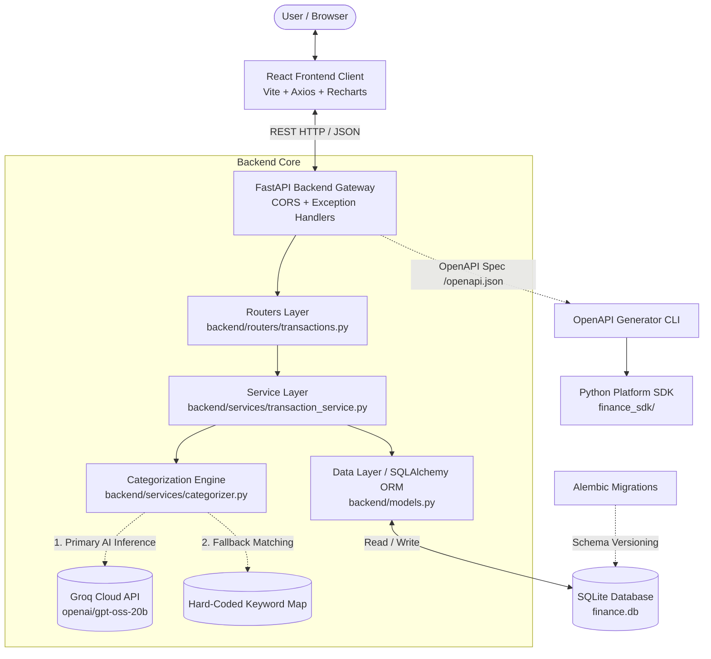
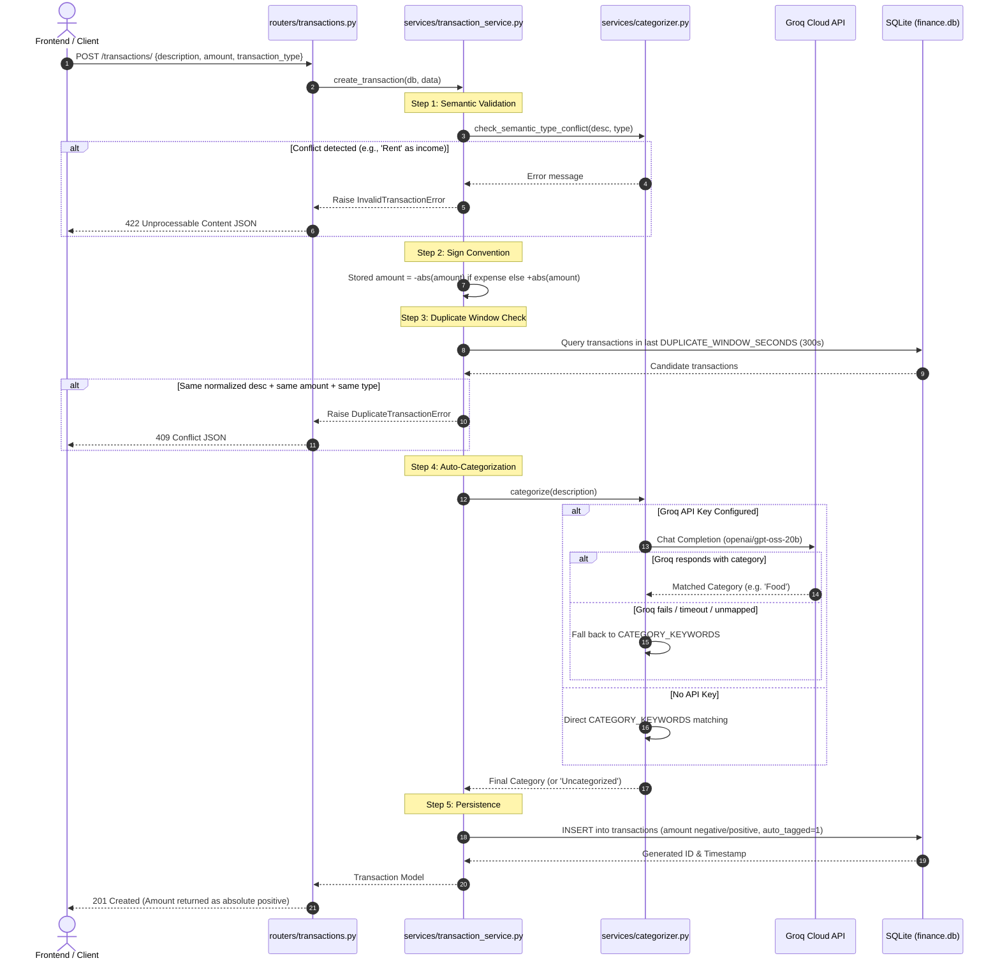
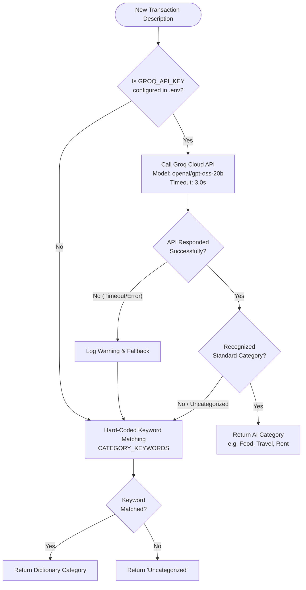
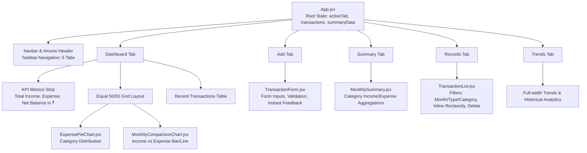
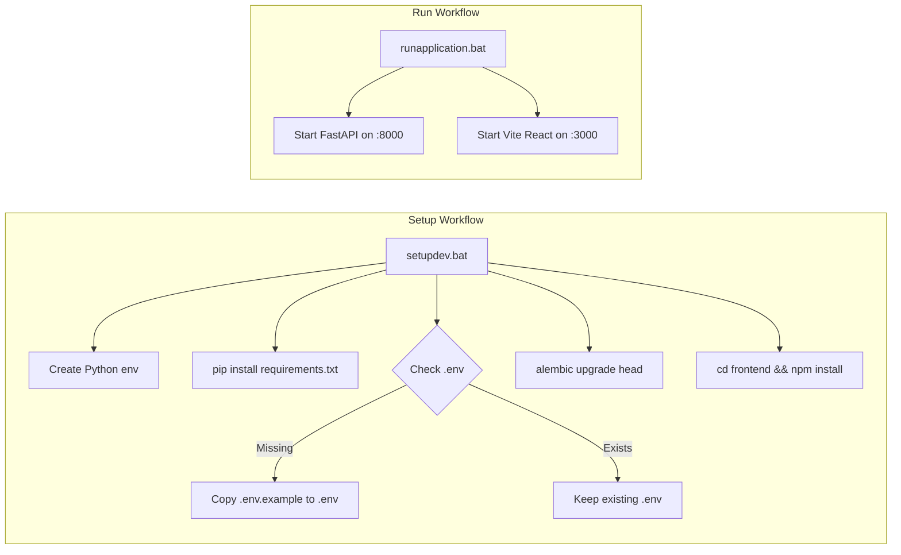

# Personal Finance Tracker System — Complete Workflow & Architecture Guide

This document provides an exhaustive, end-to-end breakdown of the **Amune Personal Finance Tracker System**. It covers the complete request lifecycle, architectural patterns, database schemas, "trick logic" rules, AI categorization pipeline, frontend state flow, and SDK integration.

---

## 1. High-Level System Architecture

The application is structured into four distinct, loosely coupled layers following **Clean Architecture** principles:



---

## 2. Complete Transaction Creation Workflow (`POST /transactions/`)

When a user submits a transaction (or via the SDK / API), the backend executes a rigorous 6-step pipeline before committing to the database:



---

## 3. Database Architecture & Alembic Migrations

### 3.1 Table Schema (`transactions`)
The database is backed by SQLite (`finance.db`) conforming strictly to the specification schema:

| Column | Type | Constraints | Description |
|---|---|---|---|
| `id` | `INTEGER` | `PRIMARY KEY AUTOINCREMENT` | Unique identifier for each transaction |
| `description` | `TEXT` | `NOT NULL` | User-provided text describing the transaction |
| `amount` | `REAL` | `NOT NULL` | Stored amount: **Negative** for expenses, **Positive** for income |
| `transaction_type` | `TEXT` | `NOT NULL`, `CHECK(type IN ('income','expense'))` | Type discriminator enforced at the database level |
| `category` | `TEXT` | `NULLABLE` | Classified category name (e.g., Food, Transport) |
| `auto_tagged` | `BOOLEAN`| `NOT NULL DEFAULT 1` | `1` if categorized automatically; `0` if reclassified manually |
| `timestamp` | `TIMESTAMP`| `DEFAULT CURRENT_TIMESTAMP` | UTC timestamp of transaction creation |

### 3.2 Migration Workflow (Alembic)
- Configuration: [`alembic.ini`](file:///d:/sem-9/Amune_TASK/alembic.ini) pointing to [`alembic/`](file:///d:/sem-9/Amune_TASK/alembic/).
- Migration Script: [`alembic/versions/0a913ffcb657_create_transactions_table.py`](file:///d:/sem-9/Amune_TASK/alembic/versions/0a913ffcb657_create_transactions_table.py).
- Applied via: `alembic upgrade head` (automatically invoked by `setupdev.bat`).

---

## 4. Backend "Trick Logic" & Business Rules

### 4.1 Sign Convention
- **Inbound Client Rule**: Clients must always submit a strictly positive value (`amount > 0`). Pydantic validates `Field(..., gt=0)`.
- **Database Storage Rule**:
  - `expense` $\rightarrow$ stored as `-abs(amount)`
  - `income` $\rightarrow$ stored as `+abs(amount)`
- **Outbound Client Rule**: The API always exposes absolute positive values (`abs(amount)`) in `TransactionOut` and summary aggregations so UI components and SDK clients receive consistent numerical representations.

### 4.2 Duplicate Detection (Sliding Window)
- **Window Length**: Configured via `DUPLICATE_WINDOW_SECONDS` (default: `300` seconds / 5 minutes).
- **Match Criteria**:
  1. Transaction falls within `[now - 300s, now]`.
  2. Transaction type matches (`income` == `income` or `expense` == `expense`).
  3. Stored amount matches: `abs(candidate.amount - new.amount) < 1e-4`.
  4. Normalized description matches: `normalize_text(candidate.description) == normalize_text(new.description)`.
- **Outcome**: Triggers `DuplicateTransactionError`, mapped to **`409 Conflict`**. Duplicate entries submitted outside the 300s window are permitted.

### 4.3 Semantic Type Conflict Validation
Rejects logically conflicting transactions before writing to the database:
- **Expense-Only Keywords**: `rent`, `mortgage`, `groceries`, `grocery`, `uber`, `ola`, `taxi`, `netflix`, `spotify`, `electricity`, `fuel`, `petrol`, `restaurant`, `coffee`, `pharmacy`.
  - Example: Entering `"Monthly Apartment Rent"` as `"income"` $\rightarrow$ **`422 Unprocessable Content`**.
- **Income-Only Keywords**: `salary`, `paycheck`, `payroll`, `dividend`, `bonus`, `stipend`, `wages`.
  - Example: Entering `"Company Salary"` as `"expense"` $\rightarrow$ **`422 Unprocessable Content`**.

### 4.4 Category Reclassification (`PATCH`)
- Endpoint: `PATCH /transactions/{transaction_id}/reclassify`.
- When a category is manually changed:
  1. `category` updates to the new string value.
  2. `auto_tagged` is permanently set to `0` (`False`).
  3. Ensures that human corrections are audited and never overwritten by automatic heuristics.

---

## 5. AI Auto-Categorization Pipeline (Groq + Keyword Fallback)



- **Groq AI Integration**: Uses `openai/gpt-oss-20b` (low-latency reasoning model) with temperature `0.0`.
- **Security Policy**: `.env` is listed in `.gitignore` and never committed to source control. Evaluators configure their own key in `.env` or run on the built-in keyword dictionary.

---

## 6. Frontend Client Workflow & Component Hierarchy

The frontend is built with React 18, Vite, Axios, and Recharts.



### Key Frontend Features:
1. **Taskbar Tabs**: Five isolated tabs (`Dashboard`, `Add`, `Summary`, `Records`, `Trends`) prevent infinite vertical scrolling.
2. **Indian Rupee (`₹`) Localization**: All currency displays (KPIs, tables, forms, chart tooltips) uniformly format currency in `₹`.
3. **Half-and-Half Charts Layout (`1fr 1fr`)**: The pie chart and bar trend cards share equal 50% width on the dashboard.
4. **Real-Time Polling & Mutation Sync**: Adding, reclassifying, or deleting a transaction triggers an immediate data reload across all components.

---

## 7. Python Platform SDK Workflow

The client SDK ([`finance_sdk/`](file:///d:/sem-9/Amune_TASK/finance_sdk/)) is auto-generated using `@openapitools/openapi-generator-cli` from the backend's OpenAPI contract.

### 7.1 SDK Generation Pipeline
```bash
openapi-generator-cli generate -i http://localhost:8000/openapi.json -g python -o finance_sdk
```

### 7.2 SDK Usage Pattern
```python
from finance_sdk import ApiClient
from finance_sdk.api.transactions_api import TransactionsApi
from finance_sdk.models.transaction_create import TransactionCreate

# 1. Initialize API Client
client = ApiClient()
api = TransactionsApi(client)

# 2. Add Transaction
new_tx = api.create_transaction(
    transaction_create=TransactionCreate(
        description="Dinner at Italian Bistro",
        amount=45.0,
        transaction_type="expense"
    )
)

# 3. Retrieve Summary
summaries = api.get_summary(month="2026-10")

# 4. Reclassify
updated = api.reclassify_transaction(
    transaction_id=new_tx.id,
    reclassify_request={"category": "Food"}
)
```

### 7.3 Automated SDK Verification
The test script [`sdk_smoke_test.py`](file:///d:/sem-9/Amune_TASK/sdk_smoke_test.py) tests all 5 endpoints via the SDK against the live server:
```cmd
python sdk_smoke_test.py
```
Outputs: `All SDK smoke test assertions passed successfully!`

---

## 8. Development Scripts & DevOps Workflow



- **`setupdev.bat`**: Bootstraps the entire project from a clean clone without manual configuration.
- **`runapplication.bat`**: Launches the FastAPI backend and Vite frontend dev servers in independent command windows.
- **`pytest -v`**: Executes all 42 automated tests covering CRUD, deduplication, sign convention, AI categorization, and SDK tests.
